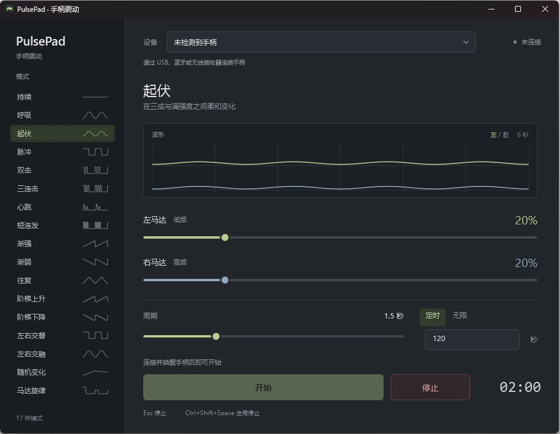

# make yuou 手柄 like jumpegg

## 这是个啥玩意

大概十年前看到某知名up的妙妙视频，一直想试试，感谢gpt大人生产了这坨AIslop
不得不说xbox手柄的x轴线性马达比几块钱的转子马达手感好多了（





## 咋用
你可以在点这个链接在网页使用[PulsePad 网页版](https://nanamikite.github.io/PulsePad/)
也可以把release那个安装包解压到任意目录，里面有个 PulsePad.exe，双击运行就行。第一次运行会提示安装 SDL2 驱动，点确定即可。

## 16 种模式

| 模式 | 节奏 |
| --- | --- |
| 持续 | 保持设定强度 |
| 呼吸 | 平滑地增强、减弱 |
| 起伏 | 在设定强度的 30%–100% 之间变化 |
| 脉冲 | 半拍震动、半拍暂停 |
| 双击 | 两次短震后停顿 |
| 三连击 | 三次短震后停顿 |
| 心跳 | 一下重、一下轻，再停顿 |
| 短连发 | 四次快速震动，再停顿 |
| 渐强 / 渐弱 | 从弱到强 / 从强到弱循环 |
| 往复 | 匀速增强，再匀速减弱 |
| 阶梯上升 / 阶梯下降 | 分五档增强 / 减弱 |
| 左右交替 | 两侧各震动半拍 |
| 左右交融 | 一侧增强，另一侧减弱 |
| 随机变化 | 每拍改变强度，平滑衔接；预览与播放使用相同的伪随机序列 |
括弧（那个音乐模式当不存在就行
## 手柄兼容范围

我只试了xbox one的手柄，但是让astra大人加了兼容层所以能不能用难说

PS3、特殊转接器和仿制手柄依赖其 Windows 驱动及 SDL 支持，不能保证所有型号可用。普通 Joy-Con 充电握把不会自动提供 USB 手柄数据连接。程序不安装驱动、不修改蓝牙配对，也不自动创建虚拟 Xbox 手柄。


## 源码和验证

在项目目录运行：

```powershell
powershell -NoProfile -ExecutionPolicy Bypass -File .\build.ps1
```
构建后运行 `PulsePad.exe`。便携包在 `build\PulsePad-Windows.zip`，解压后保留旁边的 `native` 文件夹。ZIP 仅包含程序、手柄兼容库和许可证。MIDI 可直接导入；MP3 / WAV 导入需要系统安装 FFmpeg。

跑不起来就把报错扔给豆包问：豆包豆包，为什么这个报错，然后你豆包姐就会给你最直白，最不绕弯子的回答（


实现依据：[Microsoft XInputSetState](https://learn.microsoft.com/en-us/windows/win32/api/xinput/nf-xinput-xinputsetstate)、[XINPUT_VIBRATION](https://learn.microsoft.com/en-us/windows/win32/api/xinput/ns-xinput-xinput_vibration)、[SDL 震动接口](https://wiki.libsdl.org/SDL3/SDL_RumbleJoystick)、[SDL 设备能力](https://wiki.libsdl.org/SDL3/SDL_GetJoystickProperties)、[PS 蓝牙增强报告](https://wiki.libsdl.org/SDL3/SDL_HINT_JOYSTICK_ENHANCED_REPORTS)、[SDL 官方发行版](https://github.com/libsdl-org/SDL/releases/tag/release-3.4.18)。

## 许可证

本项目采用 [GNU GPL v3.0](LICENSE)（`GPL-3.0-only`）。

SDL 保留其[原许可证](vendor/SDL/LICENSE.txt)。
